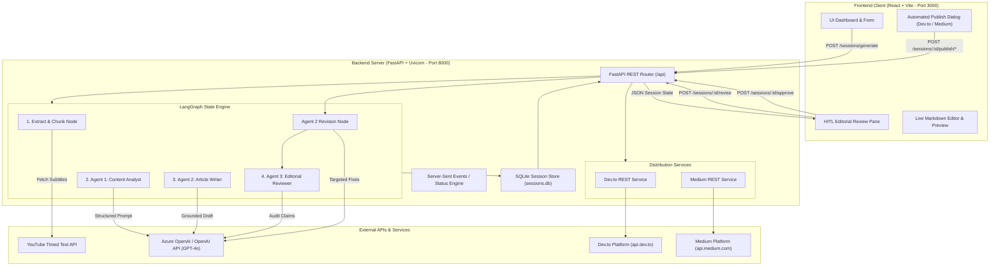
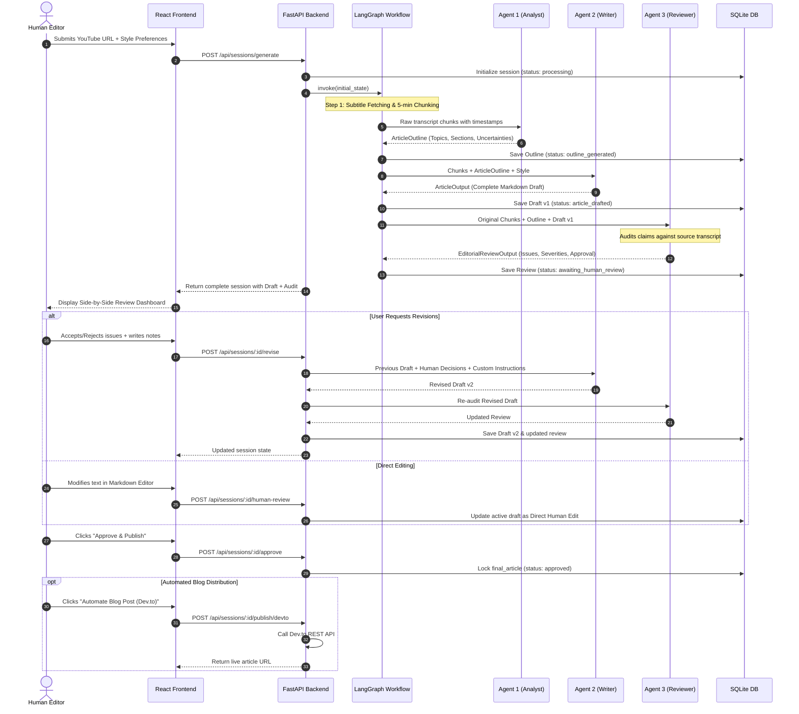

# 🏗️ PodResearch System Architecture

A comprehensive technical architecture guide for the **PodResearch** platform: an autonomous multi-agent content synthesis and quality-control system built with **LangGraph**, **LangChain**, **FastAPI**, **React (Vite)**, and a **Human-in-the-Loop (HITL)** editorial review workflow.

---

## 1. High-Level System Overview

PodResearch transforms unstructured, spoken video transcripts (YouTube podcasts, technical talks, tutorials) into publication-ready, deeply grounded technical articles.

Instead of relying on a single monolithic prompt, the system decouples the pipeline into specialized autonomous agents governed by a stateful graph:
1. **Extraction & Chunking**: Subtitle ingestion and deterministic 300-second windowing.
2. **Agent 1 (Content Analyst)**: Semantic outline generation, timestamp tracking, and uncertainty flagging.
3. **Agent 2 (Article Writer)**: Technical Markdown authoring with code blocks and section styling.
4. **Agent 3 (Editorial Reviewer)**: Adversarial quality control, fact verification, and transcript grounding audit.
5. **Human-in-the-Loop (HITL) Review**: Granular human decision overrides, direct Markdown editing, and revision loops.
6. **Automated Publishing**: Direct distribution to developer blog platforms (Dev.to and Medium).

---

## 2. System Topology



---

## 3. Codebase Organization

The production codebase is strictly decoupled into a Python backend and a modern React frontend:

```text
podresearch-agent/
├── run.sh                     # Single-command launcher (FastAPI + Vite)
├── README.md                  # Project overview & quickstart
├── ARCHITECTURE.md            # Technical system architecture guide
├── .env                       # Environment configuration
├── backend/                   # FastAPI + LangGraph Multi-Agent Backend
│   ├── run.py                 # Backend entrypoint (Uvicorn server)
│   ├── requirements.txt       # Python dependencies
│   ├── pyproject.toml         # Packaging metadata
│   ├── .env.example           # Environment template
│   ├── README.md              # Backend API reference
│   └── app/
│       ├── config.py          # Centralized settings & ChatOpenAI client
│       ├── schemas.py         # Pydantic v2 data models for Agents 1-3 & API
│       ├── agents/
│       │   ├── content_analyst.py     # Agent 1: Thematic outline synthesis
│       │   ├── article_writer.py      # Agent 2: Drafting & revision engine
│       │   └── editorial_reviewer.py  # Agent 3: Video grounding auditor
│       ├── utils/
│       │   ├── transcript.py  # Subtitle extraction with backoff
│       │   └── chunking.py    # 300s windowing segmenter
│       ├── services/
│       │   ├── devto_service.py       # Dev.to REST API integration
│       │   └── medium_service.py      # Medium REST API integration
│       ├── storage/
│       │   └── session_store.py       # Thread-safe SQLite persistence
│       ├── graph/
│       │   ├── state.py       # LangGraph TypedDict state schema
│       │   └── workflow.py    # LangGraph StateGraph pipeline
│       └── api/
│           ├── routes.py      # REST endpoints & SSE streaming
│           └── main.py        # FastAPI app factory & CORS configuration
│
└── frontend/                  # React (Vite) User Interface
    ├── package.json           # Dependencies (React 18, Vite 5, Lucide icons)
    ├── vite.config.js         # Port 3000, /api proxy & allowedHosts
    ├── index.html             # HTML entry point
    └── src/
        ├── App.jsx            # State coordinator for pipeline & review
        ├── api.js             # Async REST client
        ├── index.css          # Responsive dark/modern developer styling
        ├── main.jsx           # React DOM root
        └── components/
            ├── Header.jsx             # Top bar with backend health indicator
            ├── PipelineStepper.jsx    # 6-stage visual pipeline tracker
            ├── InputForm.jsx          # URL, style presets & options
            ├── ArticleEditor.jsx      # Markdown editor, preview & outline tab
            ├── EditorialFeedback.jsx  # Agent 3 audit cards & revision controls
            └── FinalApprovalView.jsx  # Publication screen & Dev.to/Medium automation
```

---

## 4. Multi-Agent Pipeline Lifecycle

The lifecycle follows an explicit state-machine design implemented via LangGraph's `StateGraph`.



---

## 5. Agent Responsibilities & Guardrails

| Agent | Core Responsibility | Input Artifacts | Output Artifacts | Primary Guardrails |
| :--- | :--- | :--- | :--- | :--- |
| **Agent 1: Content Analyst** | Synthesize raw transcript buckets into a coherent thematic structure. | Transcript chunks (with `start_timestamp`, `end_timestamp`, and line timestamps). | `ArticleOutline`: Title, summary, takeaways, section outlines, flagged uncertainties. | **No 1:1 chunk mapping**; eliminates channel fluff (intros, promos); preserves exact timestamps; isolates ambiguous facts. |
| **Agent 2: Article Writer** | Transform spoken language into structured, publication-grade technical Markdown. | Chunks, `ArticleOutline`, style preferences, target audience, video context. | `ArticleOutput`: Title, full Markdown article, word count. | **Strict transcript grounding**; retains code/commands; includes source timestamps; mandatory `## Uncertainties and Points to Verify` section. |
| **Agent 3: Editorial Reviewer** | Adversarial auditor verifying claims, timestamps, and outline completeness. | Original chunks, `ArticleOutline`, generated article. | `EditorialReviewOutput`: Approved status, overall critique, categorized issues list. | **Read-only critic (does not rewrite)**; distinguishes unsupported vs technically false claims; audits timestamp existence. |
| **Agent 2 (Revision Mode)** | Re-write draft targeted specifically to human and critic feedback. | Previous draft, accepted critique issues, human override instructions, chunks, outline. | Revised `ArticleOutput`. | **Human decisions strictly override Agent 3**; preserves approved sections without introducing regressions. |

---

## 6. Data Architecture & Schemas

### 6.1 LangGraph State Schema (`PodcastArticleState`)

The state dictionary is passed across all LangGraph nodes:

```python
class PodcastArticleState(TypedDict, total=False):
    session_id: str
    podcast_url: str
    video_title: str
    video_description: str
    article_style: str
    target_audience: Optional[str]
    transcript: str
    chunks: List[Dict[str, Any]]
    outline: Dict[str, Any]
    article: Dict[str, Any]
    review: Dict[str, Any]
    revision_count: int
    status: str
```

### 6.2 Pydantic Data Contracts

All agent outputs and REST payloads enforce strict Pydantic v2 validation:
- **`ArticleOutline`**: Hierarchical outline with sections, key points, timestamp intervals, and technical examples.
- **`ArticleOutput`**: Complete formatted Markdown prose, polished headline, and word count.
- **`EditorialReviewOutput`**: Boolean approval flag, qualitative summary, and typed issue items (`ReviewIssue`) with severity ratings (`high`, `medium`, `low`).
- **`PublishDevtoRequest` & `PublishMediumRequest`**: Payload definitions for external publishing services.

### 6.3 Persistence Architecture (SQLite)

The database schema (`sessions.db`) manages session persistence, revision histories, and publication records:

```sql
CREATE TABLE IF NOT EXISTS sessions (
    session_id TEXT PRIMARY KEY,
    podcast_url TEXT NOT NULL,
    video_title TEXT,
    video_description TEXT,
    status TEXT NOT NULL,
    transcript TEXT,
    chunks_json TEXT,
    outline_json TEXT,
    article_json TEXT,
    review_json TEXT,
    history_json TEXT,
    final_article TEXT,
    medium_url TEXT,
    created_at TIMESTAMP DEFAULT CURRENT_TIMESTAMP,
    updated_at TIMESTAMP DEFAULT CURRENT_TIMESTAMP
);
```

---

## 7. Frontend Architecture (React + Vite)

The frontend is organized around single-responsibility components communicating with the FastAPI backend through a unified API client:

- **`Header.jsx`**: Displays real-time backend connection status and session reset controls.
- **`PipelineStepper.jsx`**: Visual 6-stage tracker showing active pipeline progress from Extraction to Publication.
- **`InputForm.jsx`**: YouTube URL input, style presets, audience specification, and generation triggers.
- **`ArticleEditor.jsx`**: Dual-mode Markdown view:
  - Formatted preview with styled typography and code highlighting.
  - Direct raw Markdown editor with instant persistence.
  - Agent 1 Outline reference drawer.
  - Historical version restore tabs.
- **`EditorialFeedback.jsx`**: Side-by-side quality-control panel displaying Agent 3's issue audit cards, granular Accept/Reject toggles, custom instruction fields, and the Agent 2 revision trigger.
- **`FinalApprovalView.jsx`**: Post-approval certification screen offering 1-click Markdown copying, `.md` file download, and automated publishing to **Dev.to** and **Medium**.

---

## 8. Reliability, Security & Operational Safeguards

1. **LLM Execution Guardrails**:
   - `timeout=45s` and `max_retries=1` configured on the `ChatOpenAI` client to prevent thread starvation and hanging connections.
2. **Deterministic Grounding**:
   - Agent 3 operates strictly as an adversarial inspector comparing the generated text to the source transcript, preventing unchecked hallucination compounding.
3. **Network & Host Isolation**:
   - Backend binds to `0.0.0.0` with configurable CORS origins.
   - Vite dev server configures `allowedHosts: true` and reverse proxies `/api` requests to port `8000`, enabling seamless local network and tunnel access without CORS errors.
4. **Credential Isolation**:
   - API tokens (OpenAI, Dev.to, Medium) are managed via server-side `.env` configuration or transient local browser storage, never hardcoded in the codebase.
